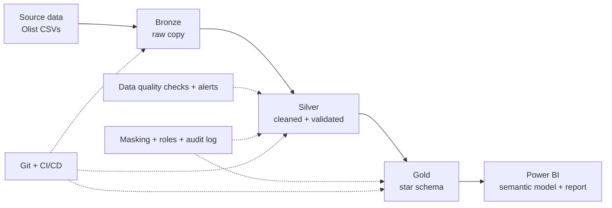

# Fabric Retail Pipeline

A secure, end-to-end data engineering project on **Azure and Microsoft Fabric**. It takes raw e-commerce data, cleans it, checks its quality, protects personal information, and turns it into report-ready tables.

> **Status:** In progress. See the [Roadmap](#roadmap) for what is done and what is next.

---

## What this project shows

| Skill | Where it appears in this project |
|---|---|
| Data pipelines (ETL/ELT) | Ingestion with Azure Data Factory / Fabric pipelines, transforms in SQL and Python |
| Lakehouse and warehouse design | Bronze, Silver and Gold layers; star schema in a Fabric warehouse |
| Semantic modelling | Power BI semantic model on top of the Gold layer |
| Data quality | Validation checks, monitoring and alerts |
| Security and privacy | Data masking, role-based access, audit logging |
| Governance | Data classification and retention documentation |
| Engineering practice | Git, CI/CD with GitHub Actions, small infrastructure-as-code example |

---

## Architecture



### Layers in simple words

- **Bronze:** an exact copy of the original files. Nothing is changed here.
- **Silver:** cleaned data (fixed types, removed duplicates, handled nulls) with quality checks and masked personal fields.
- **Gold:** business-ready tables in a star schema, built for reporting.

---

## Dataset

[Brazilian E-Commerce Public Dataset by Olist](https://www.kaggle.com/datasets/olistbr/brazilian-ecommerce) (Kaggle): about 100,000 orders across customers, orders, items, payments, products and reviews.

The dataset is mostly anonymised. To practise privacy controls, this project generates **fake** personal fields (name, email, phone) using the Python library [Faker](https://faker.readthedocs.io/). No real personal data is used anywhere.

The raw data files are not stored in this repository. Download them from Kaggle and place them in `data/raw/`.

---

## Tech stack

- **Cloud:** Microsoft Azure, Microsoft Fabric (lakehouse, pipelines, warehouse, semantic model)
- **Orchestration:** Azure Data Factory / Fabric pipelines
- **Languages:** SQL, Python (pandas, PySpark where needed)
- **Quality and privacy:** custom validation checks, Faker for test data
- **Delivery:** Git, GitHub Actions, Bicep (small example)
- **Reporting:** Power BI

---

## Data quality

Checks are run on the Silver layer, and failures raise an alert. Planned checks include:

- No null values in key columns
- No duplicate order IDs
- Values within expected ranges (for example, price greater than 0)
- Valid foreign keys between tables
- Row counts compared between layers

---

## Security and privacy

- **Masking:** personal fields are masked before they reach the reporting layer (for example, `r***@mail.com`).
- **Access control:** separate roles for analysts (masked data only) and admins (full data).
- **Audit logging:** a log records who accessed which data and when.
- **Governance docs:** data classification and retention policy in [`docs/`](docs/).

These follow common enterprise security practices. This is a learning project and has not been formally audited or certified.

---

## Repository structure

```
fabric-retail-pipeline/
├── data/
│   └── raw/            # original files (not committed)
├── src/                # Python scripts and SQL
├── docs/               # architecture, data classification, retention policy
├── .github/workflows/  # CI/CD pipeline
└── README.md
```

---

## Getting started

1. Clone this repository.
2. Download the Olist dataset from Kaggle and place the CSV files in `data/raw/`.
3. Create a Python environment and install the requirements:
   ```bash
   python -m venv .venv
   source .venv/bin/activate
   pip install -r requirements.txt
   ```
4. Run the Bronze ingestion script:
   ```bash
   python src/ingest_bronze.py
   ```

*Setup steps for Azure and Fabric will be added as they are built.*

---

## Roadmap

- [x] Create repository and folder structure
- [ ] Bronze layer: ingest raw files
- [ ] Silver layer: clean and validate data
- [ ] Gold layer: star schema in a Fabric warehouse
- [ ] Semantic model and Power BI report
- [ ] Data quality checks and alerts
- [ ] Masking, roles and audit logging
- [ ] CI/CD with GitHub Actions
- [ ] Small Bicep infrastructure-as-code example
- [ ] Data classification and retention documentation
- [ ] Short demo video

---

## Author

**Pratham Mevada**
Computer Science Engineering student, focused on data engineering.

- GitHub: [Prathammevada1](https://github.com/Prathammevada1)
- LinkedIn: [pratham-mevada](https://www.linkedin.com/in/pratham-mevada-763b34290)
